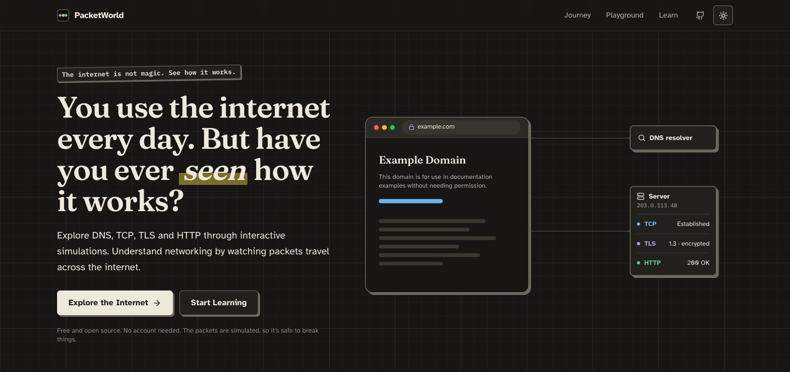
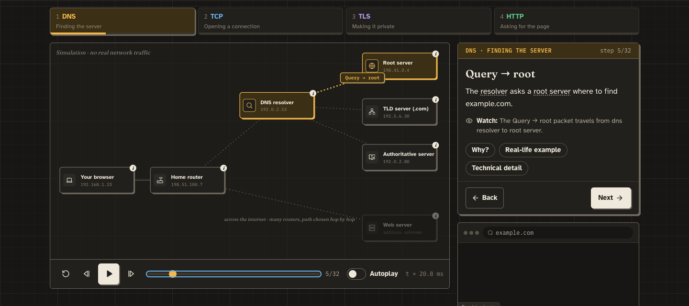
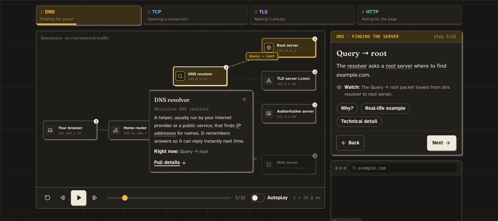
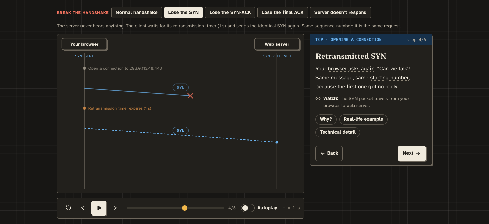
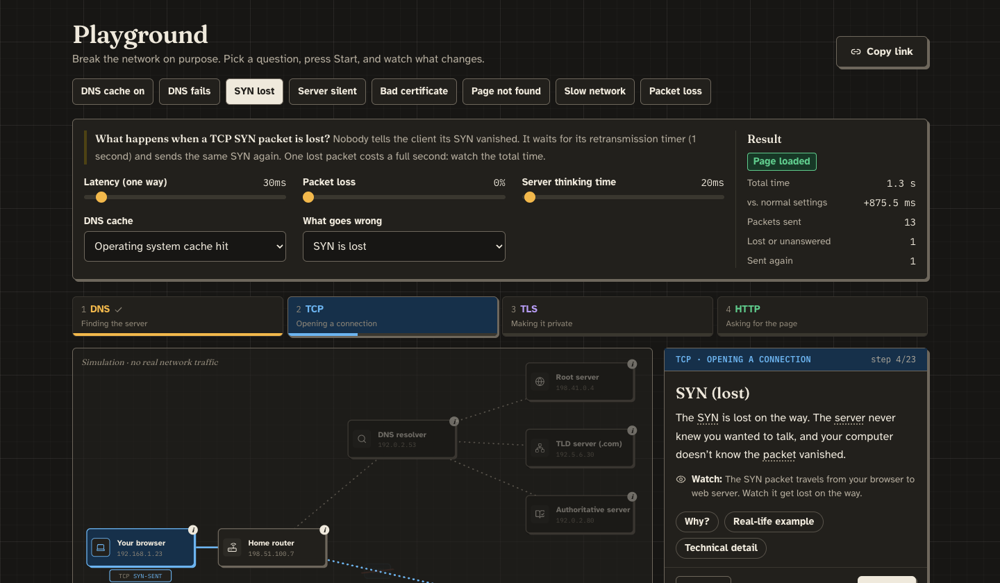
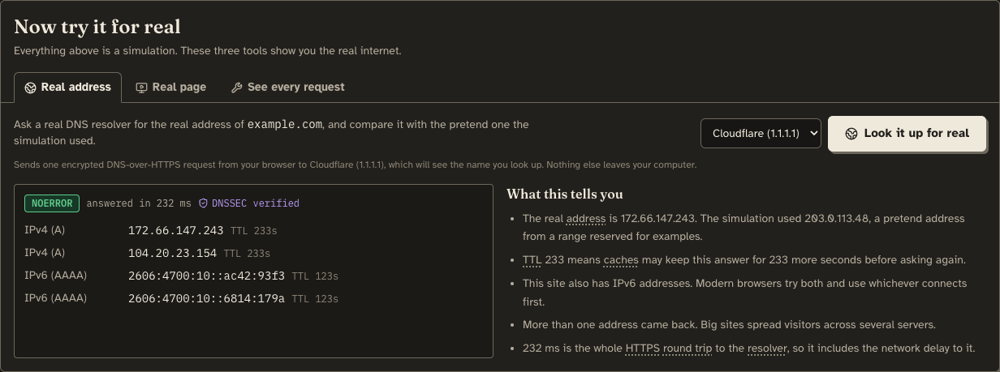
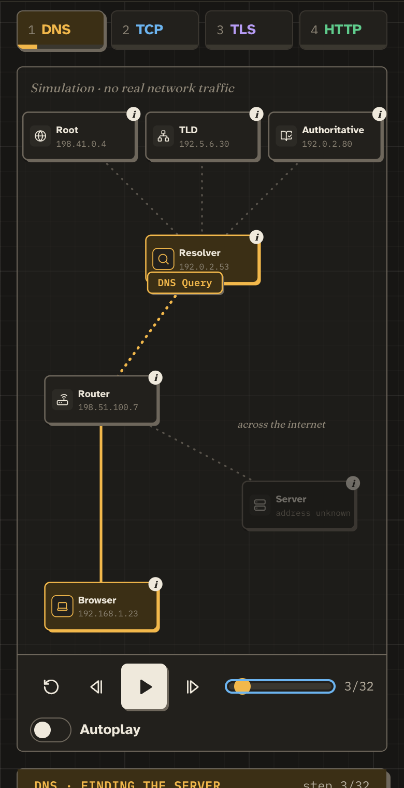

# PacketWorld

**The internet is not magic. See how it works.**

**Live site:** https://packetworld.vercel.app

PacketWorld is an open-source, interactive learning platform that shows what actually happens when you open a website. Type a URL, press **Start Journey**, and watch every packet travel from your browser to a server and back, through DNS, TCP, TLS and HTTP. Pause anywhere, step backwards, click any machine or packet to look inside, and break things on purpose to see how the protocols recover.

> The journey is a deterministic simulation: it behaves the same for everyone and is safe to use in a classroom. The only real network request is the optional **Look it up for real** button, which asks a public DNS resolver for a site's real address, and only when you click it.



▶ **[Watch the intro video](docs/media/packetworld-intro.mp4)**

## See it in action

**Journey: follow every packet.** The simulation stops after each step and explains it in a sentence or two. Here the DNS resolver is asking a root server where to find example.com.



**Tap anything to learn what it is.** Every machine and packet opens a small explainer right where you tapped. Underlined words have one-line definitions.



**Break things on purpose.** Lose the SYN and watch TCP wait one second and send it again, with the same sequence number.



**Playground.** Pick an experiment, turn the dials, and see what it costs.



**Try it for real.** Look up a site's real addresses over DNS-over-HTTPS and compare them with the simulation.



<p align="center"></p>

## Features

- **Dark or light.** A dark chalkboard look by default, with a one-click light theme.
- **Guided by default.** The simulation stops after every step and explains it in one or two sentences. "Why?", "Real-life example" and "Technical detail" open on request; Autoplay is one switch away.
- **Tap anything to learn.** Every machine and packet on the map opens a small explainer bubble right where you tapped, and key words in explanations are clickable.
- **Try it for real.** Look up a site's real IPv4 and IPv6 addresses, TTLs and DNSSEC status over DNS-over-HTTPS, and compare them with the simulation.
- **Journey mode.** An animated network map (browser, home router, DNS resolver, root, TLD and authoritative servers, web server) with play, pause, step, scrub and speed controls, and keyboard shortcuts (Space, ← and →).
- **Packet inspector.** Every packet shows its source and destination, protocol layers (IPv4, UDP/TCP, DNS, TLS, HTTP) and real header fields, plus what an on-path observer can still see when it is encrypted.
- **Beginner and technical modes.** One switch changes every explanation, from plain language with real-life comparisons to protocol detail with RFC references.
- **Failure scenarios.** NXDOMAIN, lost SYN, lost SYN-ACK, lost final ACK, an unresponsive server, an expired certificate and HTTP 404, each explained step by step.
- **Playground.** Dials for latency, packet loss, server response time and DNS cache state, eight guided experiments, a timing waterfall, and shareable links.
- **Learn.** Ten interactive lessons (how the internet works, IP addresses and ports, DNS, TCP vs UDP, the TCP handshake, TLS/HTTPS, HTTP, routing, NAT and firewalls, latency and loss), each with a lab, two levels of explanation and a quiz.
- **Accurate by design.** DNS caching, UDP and QUIC, TLS 1.3, hop-by-hop routing and visible metadata are all represented honestly. Every simplification is documented in [docs/ACCURACY.md](docs/ACCURACY.md).
- **No account, no backend, no tracking.** Lesson progress is stored only in your browser.

## Quick start

Requires Node.js 20 or later (see `.nvmrc`).

```sh
npm install
npm run dev        # start the dev server at http://localhost:5173
npm test           # run the simulation test suite
npm run typecheck  # TypeScript, no emit
npm run build      # production build in dist/
```

## How it is built

React, TypeScript and Vite, with Tailwind CSS for styling (a "lab notebook" look: paper, ink and protocol-coloured markers), SVG for the diagrams and Framer Motion for small UI transitions. The protocol simulation in [`src/sim`](src/sim) is plain TypeScript with no React imports: it turns a configuration into an ordered list of events that the UI plays back.

```
src/
  sim/            Protocol simulation (pure, deterministic, tested)
  live/           The optional real DNS-over-HTTPS lookup
    stages/       DNS, TCP, TLS and HTTP event builders
  hooks/          usePlayback: the play/pause/step/seek clock
  components/     NetworkCanvas, Packet, PacketInspector, SimulationControls, Quiz, …
    labs/         Interactive labs used by the lessons
  content/        Lessons, quizzes, experiments, glossary, machine descriptions
  pages/          Landing, Journey, Playground, Learn, Lesson
  landing/        The animated landing hero (built with the Stageshow kit)
  vendor/         Third-party source kept in the repo (Stageshow kit, MIT)
docs/             Architecture, accuracy notes, design system, ADRs, roadmap
```

Read [docs/ARCHITECTURE.md](docs/ARCHITECTURE.md) for the full picture and [docs/SIMULATION_MODEL.md](docs/SIMULATION_MODEL.md) for how a journey is built.

## Documentation

| Document | What it covers |
|---|---|
| [docs/ARCHITECTURE.md](docs/ARCHITECTURE.md) | Layers, data flow, folder structure, key components |
| [docs/SIMULATION_MODEL.md](docs/SIMULATION_MODEL.md) | Events, world state, timing, loss, and how to add a protocol step |
| [docs/ACCURACY.md](docs/ACCURACY.md) | Every simplification we make, and the facts we refuse to simplify |
| [docs/DESIGN_SYSTEM.md](docs/DESIGN_SYSTEM.md) | Colours, the protocol palette, type, motion, accessibility |
| [docs/CONTENT_GUIDE.md](docs/CONTENT_GUIDE.md) | How to write beginner and technical explanations, lessons and quizzes |
| [docs/ROADMAP.md](docs/ROADMAP.md) | What is done, and what comes next |
| [docs/DEPLOYMENT.md](docs/DEPLOYMENT.md) | Publishing to GitHub Pages or any static host |
| [docs/decisions/](docs/decisions) | Architecture Decision Records: why things are the way they are |

## Contributing

Contributions are very welcome, especially accuracy fixes, new lessons, translations and accessibility improvements. Start with [CONTRIBUTING.md](CONTRIBUTING.md). Found something technically wrong? Please open an **accuracy report**: for an educational tool, those are the most valuable issues.

## License

[MIT](LICENSE). The vendored Stageshow kit in `src/vendor/stageshow` is also MIT licensed; see its own `LICENSE`.
