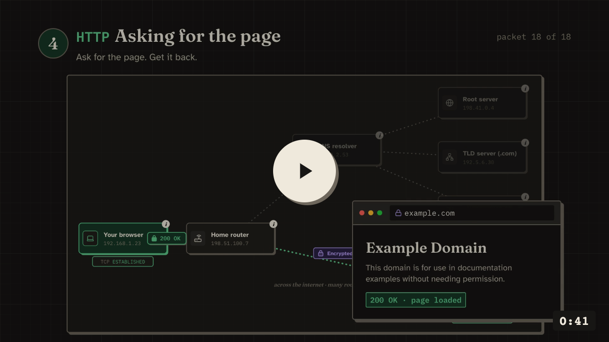

<div align="center">


# PacketWorld

**See what actually happens when you open a website.**

[Open the site](https://packetworld.vercel.app) · [Watch the intro](docs/media/packetworld-intro.mp4) · [Lessons](https://packetworld.vercel.app/#/learn) · [Report a mistake](https://github.com/opixdown/packetworld/issues/new?template=accuracy_report.md)

</div>


Most networking material explains DNS, TCP and TLS with a diagram and a wall of text. You read it, you nod, and an hour later it's gone.

PacketWorld lets you watch it instead. Type a URL, press Start, and follow every packet from your browser to the server and back. The simulation stops after each step and tells you what just happened in a sentence or two. If a word or a box on the screen doesn't make sense, tap it and a small explanation pops up right there.

I built it with a Class 11 student in mind: someone who's curious and has never heard of a three-way handshake. It goes deep enough for developers too. Switch to Technical and you get real header fields, sequence numbers and RFC references.

<a href="docs/media/packetworld-intro.mp4"></a>

## What's inside

**Journey.** The main thing. Pick any address and watch the whole trip: the DNS lookup (with or without caching), the TCP handshake, TLS 1.3 and the HTTP request. Step forward, step back, scrub, or let it autoplay.

**Tap to learn.** Every machine and every packet on the map opens a short explainer. Tricky words in the text are underlined and clickable.

**Break it on purpose.** Lose the SYN. Lose the final ACK. Expire the certificate. Make the server ignore you. Each failure plays out step by step, with the real recovery behaviour.

**Playground.** Drag sliders for latency, packet loss and server time, and see exactly where the extra seconds go.

**Ten lessons.** IP addresses and ports, DNS, TCP vs UDP, TLS, HTTP, routing, NAT and more. Each has a small interactive lab and a three-question quiz.

**Try it for real.** One button looks up a site's real IP address over DNS-over-HTTPS. Another loads the real page. A short guide shows you the same stages in your own browser's DevTools.

It also has a light and a dark theme, works on phones, and needs no account. The live site counts page views with cookieless Vercel Analytics, and that's all it collects.

<table>
  <tr>
    <td width="50%"></td>
    <td width="50%"></td>
  </tr>
  <tr>
    <td>The resolver asking a root server where example.com lives</td>
    <td>Tap any machine to see what it does</td>
  </tr>
  <tr>
    <td></td>
    <td></td>
  </tr>
  <tr>
    <td>Losing a SYN, then watching TCP send it again a second later</td>
    <td>Playground: change the network and compare the timings</td>
  </tr>
</table>

## Is it accurate?

That's the part I care about most. The journey is a simulation, so it behaves the same for everyone and nothing touches your network. But the packets follow the real rules: sequence numbers add up from the first SYN to the last byte, DNS shows caching instead of pretending every lookup starts at the root, and encrypted packets list what someone on your Wi-Fi can still see.

Where it simplifies, it says so. [docs/ACCURACY.md](docs/ACCURACY.md) lists every shortcut and why it's there. If you spot something wrong, please [open an accuracy report](https://github.com/opixdown/packetworld/issues/new?template=accuracy_report.md). Those get fixed first.

## Run it yourself

You need Node.js 20 or newer.

```sh
git clone https://github.com/opixdown/packetworld.git
cd packetworld
npm install
npm run dev
```

Then open http://localhost:5173.

| Command | What it does |
|---|---|
| `npm run dev` | Dev server with hot reload |
| `npm test` | Simulation tests (Vitest) |
| `npm run typecheck` | TypeScript, no output |
| `npm run build` | Production build into `dist/` |

## How it's built

React, TypeScript and Vite, styled with Tailwind. The diagrams are plain SVG.

The interesting bit is `src/sim/`. It's a small, deterministic protocol simulator with no React in it: you give it a URL and some settings, and it returns an ordered list of events (a packet moving, a cache lookup, a timer firing). The UI just plays those events back. That's what makes stepping backwards, sharing a setup by link, and testing the packet maths possible.

```
src/
  sim/          the protocol simulator (DNS, TCP, TLS, HTTP), fully tested
  components/   the map, step card, inspector, lesson labs
  content/      lessons, quizzes, glossary, experiments
  pages/        Landing, Journey, Playground, Learn
docs/           architecture, accuracy notes, design system, decision records
```

More detail lives in the docs:

- [Architecture](docs/ARCHITECTURE.md) and [the simulation model](docs/SIMULATION_MODEL.md)
- [Design system](docs/DESIGN_SYSTEM.md) and [how to write lessons](docs/CONTENT_GUIDE.md)
- [Decision records](docs/decisions/README.md), if you want to know why something is the way it is
- [Roadmap](docs/ROADMAP.md). Next up: importing a real Wireshark capture and replaying it on the map.

## Contributing

Help is very welcome, especially fixes to explanations, new lessons, translations and accessibility. Read [CONTRIBUTING.md](CONTRIBUTING.md) first, then open an issue or a pull request.

## License

[MIT](LICENSE). The landing animation uses the [Stageshow](https://github.com/benjitaylor/skills/tree/main/stageshow) kit (also MIT), vendored in `src/vendor/stageshow`.
